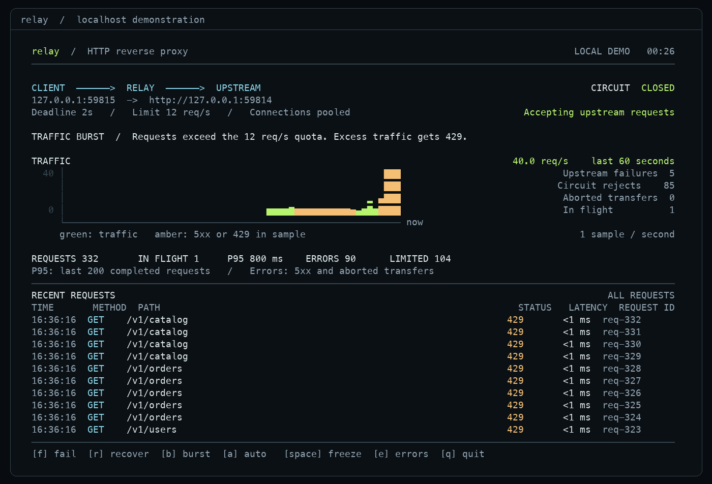

# Relay

A Go HTTP reverse proxy with a live terminal dashboard, rate limiting, and circuit breaking.

[](docs/relay-demo.mp4)

[Watch the demo](docs/relay-demo.mp4) · [CLI reference](docs/reference.md) · [Reliability notes](docs/reliability.md) · [Benchmarks](docs/benchmark.md)

Relay forwards requests to one backend and makes its failure behavior visible. The dashboard shows request rates, recent responses, p95 latency, and circuit state. The recorded demo uses real HTTP traffic to trigger an upstream outage, recovery, and rate-limit rejections.

## Try the demo

Use Go 1.26 or 1.27 and a terminal with at least 76 columns and 28 rows.

```sh
git clone https://github.com/darshmahadevia/Relay.git
cd Relay
make dashboard
```

The demo starts a local backend and generates traffic. After six seconds, the backend fails. Five failures open the circuit, and Relay rejects new requests until a recovery probe succeeds. A later traffic burst exceeds the demo's 12-request-per-second quota.

You can control the demo from the keyboard:

| Key | Action |
| --- | --- |
| `space` | Freeze or resume the display. Traffic continues. |
| `e` | Toggle the error filter. |
| `f` / `r` | Fail or recover the demo backend. |
| `b` / `a` | Start a burst or restart the automatic sequence. |
| `q` | Stop accepting connections, drain active requests, and quit. |

## Proxy your own backend

Start your backend on port 9000, then run:

```sh
go run ./cmd/proxy -backend http://localhost:9000 -listen :8080 -ui
```

Send requests through Relay from another terminal:

```sh
curl -i http://localhost:8080/
curl -i http://localhost:8080/healthz
curl -s http://localhost:8080/metrics
```

Omit `-ui` to write JSON logs to stdout. Add `-log-file /tmp/relay.jsonl` to retain JSON logs while the dashboard runs.

Build a standalone binary with `make build`. It writes `bin/reverse-proxy`. See the [CLI reference](docs/reference.md) for flags, endpoint behavior, and recording instructions.

## How requests move through Relay

```text
Client
  |
  v
Request ID + logging
  |
  +-- /healthz, /metrics --> Local response
  |
  +-- Other paths --> Rate limit --> Circuit breaker --> Deadline --> Backend
```

HTTP forwarding uses Go's `net/http/httputil.ReverseProxy`. Relay adds these controls around it:

| Control | Behavior |
| --- | --- |
| Connection pooling | Reuses upstream connections and caps them at 100 per host. |
| Request deadlines | Cancels upstream work after 15 seconds by default. |
| Rate limiting | Applies one fixed-window request quota per process. |
| Circuit breaking | Opens after five consecutive failures, waits ten seconds, then admits one recovery probe. |
| Failure accounting | Counts incomplete transfers even when the upstream sent `200` headers. |
| Graceful shutdown | Waits up to ten seconds for active requests after `SIGINT` or `SIGTERM`. |
| Observability | Exposes Prometheus-compatible counters, request IDs, structured logs, and a terminal dashboard. |

The [reliability notes](docs/reliability.md) explain the shutdown and truncated-response bugs, their fixes, and the regression checks.

## Run the checks

```sh
make check
make check-dashboard
make demo
```

`make check` runs race-enabled tests, coverage, vetting, and formatting checks. The tests exercise forwarding, timeouts, rate limiting, circuit recovery, and incomplete response bodies.

The shutdown regression launches the executable and sends `SIGTERM` during an active request. `make check-dashboard` drives keyboard controls and resizing in a real pseudoterminal. These terminal checks require Python 3 on macOS or Linux.

GitHub Actions is configured to run the Go checks on Go 1.26 and 1.27. On Go 1.27, it also runs the noninteractive demo and terminal verification.

## Measure HTTP performance

```sh
make bench
```

The benchmark runs five rounds of direct and proxied HTTP requests. It reports throughput, latency percentiles, allocations, and errors. Every response must match the expected status and body, and every measured request must reach the backend.

Read the [method and recorded results](docs/benchmark.md) for the workload, hardware, profiling evidence, and measurement limits.

## Scope

Relay has one fixed upstream. Rate limits and circuit state belong to each process. It does not provide load balancing, dynamic routing, authentication, TLS termination, retries, or distributed quotas.

The core uses Go's HTTP standard library. Terminal control uses `golang.org/x/term`. Python and FFmpeg are development tools for terminal verification and recording.

## Project layout

| Path | Responsibility |
| --- | --- |
| `cmd/proxy` | CLI flags, HTTP server, dashboard startup, and shutdown. |
| `cmd/demo` | Noninteractive HTTP demo with checked outcomes. |
| `internal/proxy` | Forwarding, resilience, logs, counters, and state snapshots. |
| `internal/dashboard` | Terminal layout, traffic history, and recent requests. |
| `internal/showcase` | Controlled demo backend and HTTP traffic generator. |
| `scripts` | Benchmark, terminal verification, and recording tools. |
| `docs` | CLI reference, regression evidence, benchmark results, and demo recordings. |

## License

[MIT](LICENSE)
